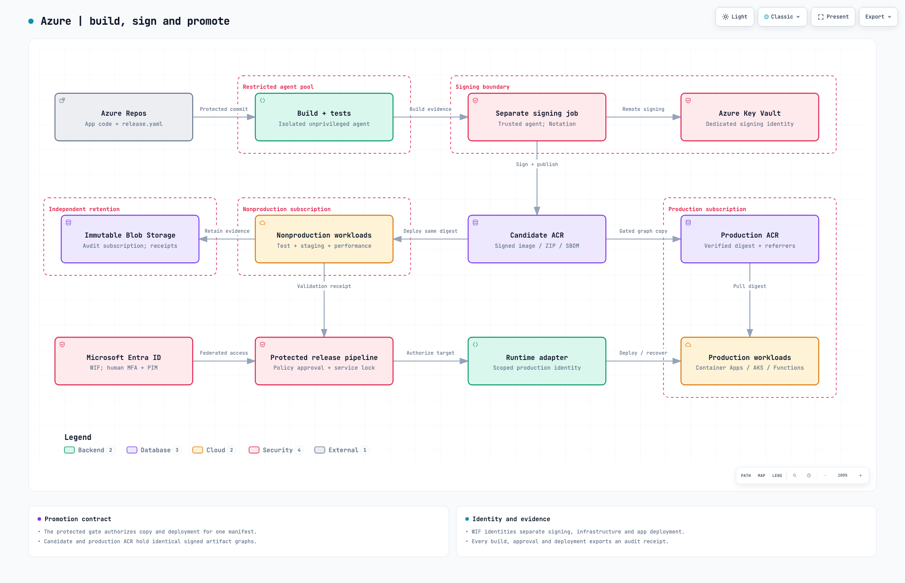
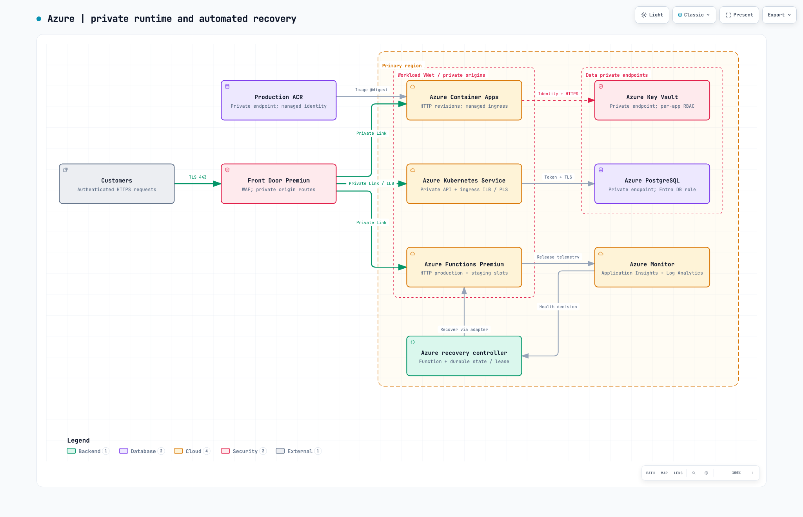
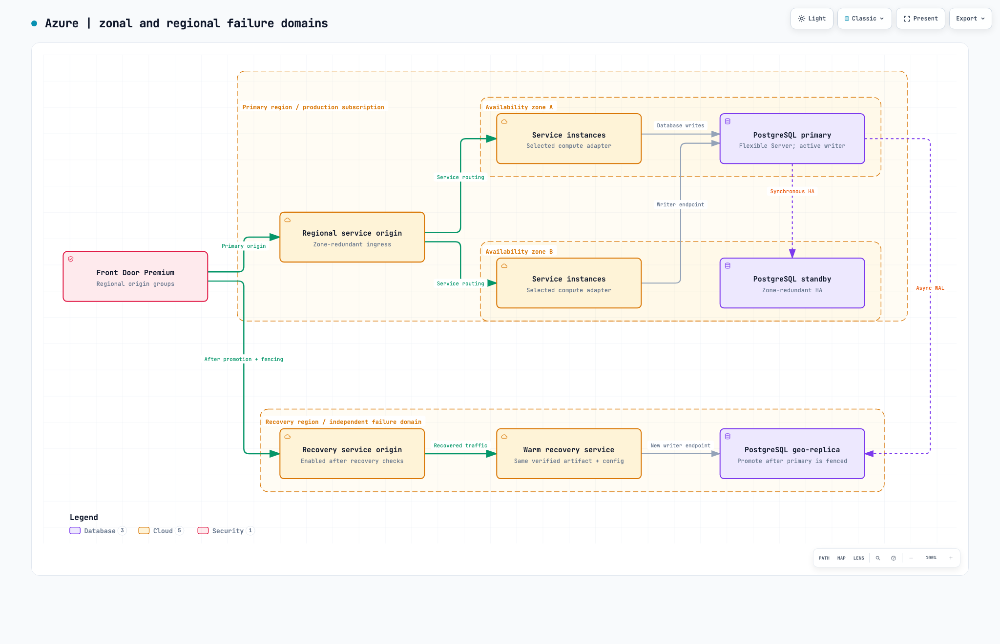

**Selected cloud: Microsoft Azure**

# Senior DevOps Engineer Assessment

**A paved-road delivery platform for forty teams**  
Design submission · 25 September 2026

## Executive summary

I propose a common release contract with three delivery adapters: Azure Container Apps, Azure Kubernetes Service (AKS), and Azure Functions Premium. Teams keep their application code, tests, service objectives and on-call ownership. The platform provides versioned templates, federated access, verified artifacts, automated recovery and a consistent evidence trail.

The first priority is to remove broad production permissions across all forty teams in the first month, independently of pipeline migration. Existing pipelines can adopt scoped workload identity federation before adopting the complete platform. A four-engineer platform team then builds and validates the catalog, policy evaluator, adapters and recovery controller, followed by staged team onboarding over sixteen weeks.

Releases get faster through parallel checks, reusable build profiles, automatic approval of established standard changes and agentless observation. Humans review changes involving infrastructure permissions, schema, exceptions or uncertain risk. Initial p85 budgets are 30 minutes from merge to first production exposure and 40 minutes to complete a standard single-region release. Critical services retain progressive exposure: 65 minutes for one region and 105 minutes for two sequential regional waves. These are proposed budgets to validate against a four-week baseline, with safety gates taking precedence.

Every release promotes the same signed artifact and records its source, configuration, policy, test evidence and approval. Container Apps uses revision traffic weights; Functions uses prewarmed slots; AKS retains GitOps with an explicitly operated rollout controller. Recovery is driven by service health, including severe low-volume failures and telemetry loss. Database changes preserve application rollback through expand/contract migrations.

My design uses a shared pipeline library, protected `extends` templates, digest promotion, separated identities, GitOps, database-domain locks and normalized deployment events. The accompanying examples and local checks make the design reviewable; Azure acceptance tests are listed at the end.

## Assumptions and scope

- Azure public cloud, one Microsoft Entra tenant and Azure DevOps Services. Production, nonproduction, platform and audit subscriptions provide separate administrative boundaries; sensitive domains receive dedicated production subscriptions.
- `orders-api` is the Container Apps HTTP example and `orders-webhook` is the Functions Premium HTTP example. West Europe (`weu`) and North Europe illustrate primary/recovery locations, subject to residency, SKU and capacity checks.
- Critical-service targets: 99.9% monthly availability, HTTP p95 below 500 ms, severe bad-release recovery within 10 minutes, and regional-disaster RTO 60 minutes/RPO 5 minutes. Load and recovery exercises must establish achievable values.
- Azure Database for PostgreSQL Flexible Server illustrates stateful delivery. Existing database engines retain validated migration adapters. Asynchronous consumers require a separate handover profile.
- This submission covers design, examples and validation. Landing-zone deployment and application rewrites are outside scope. Mandatory production controls use supported capabilities; preview features are optional evaluations.

## 1. Platform design — 25%

### Reference architecture

Three views show the same platform at different levels: artifact promotion and trust, private runtime connections and recovery, then zonal/regional failure domains.

[View full-size diagram](architecture/delivery.png) · [Diagram source](architecture/delivery.architecture.json)

The signing job has its own identity and Key Vault key. Candidate ACR supplies nonproduction deployments; successful validation and policy approval authorize a digest-preserving copy into production ACR and deployment. Entra federation serves the protected release pipeline. Every stage exports evidence to audit-owned storage; the diagram illustrates one collection link to keep the promotion path clear.

[View full-size diagram](architecture/runtime.png) · [Diagram source](architecture/runtime.architecture.json)

The primary-region boundary contains both workload and data-access boundaries. Front Door uses private origins; ACR, Key Vault, PostgreSQL and Azure Monitor are explicit dependencies. Representative artifact/data/telemetry links apply to each authorized adapter. Container runtimes pull images; the Functions adapter extracts the verified ZIP into its deployment package store. The recovery controller selects the runtime-specific rollback operation.

[View full-size diagram](architecture/resilience.png) · [Diagram source](architecture/resilience.architecture.json)

Front Door routes to one zone-redundant regional origin; the selected compute service distributes requests across its zonal instances. Two zones illustrate independent failure domains, with placement governed by the compute service. PostgreSQL HA uses a synchronous standby; the active primary separately sends asynchronous WAL to the recovery-region replica. During failover, fence the old writer and promote/validate the replica before enabling the recovery origin. [Front Door origins](https://learn.microsoft.com/en-us/azure/frontdoor/origin).

| Workload need | Azure adapter | Behavior and trade-off |
|---|---|---|
| Managed containers | Container Apps in a workload-profiles environment | Multiple revisions support HTTP traffic weights with a managed control plane. Application-scope settings affect all revisions and need compatibility review. |
| Kubernetes APIs/controllers | AKS | Retains Helm, custom controllers and GitOps. The platform operates cluster upgrades, capacity and admission controls. |
| Critical HTTP functions | Functions Premium | Slots support warm-up and reversible switching, with baseline capacity costs. Flex Consumption requires a different adapter because it lacks slots. |
| Existing web applications | App Service | Keep a slot-based adapter where it fits the application; changing the delivery contract does not require a runtime migration. |

Provider behavior: [Container Apps revisions](https://learn.microsoft.com/en-us/azure/container-apps/revisions), [Functions slots](https://learn.microsoft.com/en-us/azure/azure-functions/functions-deployment-slots).

### Versioned standards and team extension points

Separate ownership across `pipeline-tools`, `platform-infrastructure`, `platform-governance`, `platform-helm-charts` and `platform-gitops`. Release templates, scripts, policy bundles and event schemas together using semantic versions, changelogs and protected immutable tags. Record resolved commits, support the current and previous major for one quarter, and generate tested consumer upgrade PRs.

An app consumes the approved root `extends` template and declares requirements in [release.yaml](examples/release.yaml). Use the same `release_profile` field in its [pipeline YAML](examples/azure-pipelines.yml). A platform-owned catalog binds the registered service to its resource IDs, environments, identities and permitted profiles. Teams own build/test commands, health endpoints, resource needs, migrations and stricter checks. New adapters enter through the same acceptance contract.

App-controlled scripts execute in isolated jobs. Privileged signing/provisioning/deployment jobs execute platform-owned code. External Azure DevOps resource checks enforce approved branches/templates, policy decisions and exclusive locks; named pipelines receive service-connection authorization. Version and reconcile these settings through `platform-governance`, including administrator permissions and bypass auditing. [Azure Pipelines checks](https://learn.microsoft.com/en-us/azure/devops/pipelines/process/approvals?view=azure-devops).

### Build once, verify and promote

1. **Validate:** Azure Repos branch policies require review and successful parallel unit, contract, security and IaC checks. Untrusted builds use disposable agents.
2. **Package:** produce a container/Helm artifact or Functions ZIP, with pinned dependencies. Record commit, template/policy versions, digest, configuration hash, SBOM, provenance, migration hashes and test IDs in the [release manifest](examples/release-contract.yaml).
3. **Sign:** a separate trusted job validates evidence and uses Notation with a Key Vault signing key. Package ZIPs as OCI artifacts so the signed manifest binds their layer hashes. Also sign the release manifest/SBOM/provenance subjects; an image signature alone does not authenticate arbitrary referrers. [OCI signing](https://learn.microsoft.com/en-us/azure/container-registry/overview-sign-verify-artifacts).
4. **Promote:** verify the source graph, recursively copy its digest and referrers from candidate ACR to production ACR, then verify the destination. Extract Functions ZIPs without remote rebuilding and retain their SHA-256/package version. [ACR graph promotion](https://learn.microsoft.com/en-us/azure/container-registry/container-registry-manage-artifact).
5. **Release:** require this artifact's successful test/staging results, fresh scans, compatible migration state and policy approval. Bind approvals to execution, digest, target and configuration; changes invalidate the decision. Run regional waves under the service/database lock.
6. **Retain:** preserve deployed and recovery artifacts, trust material and compatibility records. Store release evidence for a proposed 365 days, adjusted by retention requirements.

Runtime identities can read production artifacts; only the promotion identity can publish them. Restrict deletion and disable registry admin credentials. Use ACR Premium where Private Link and geo-replication are required, and check recovery-region artifact availability before release.

### Faster delivery with risk-tiered approval

The protected service connection always invokes a platform-owned Azure Function/REST check. The evaluator fetches trusted run/evidence metadata and classifies risk; an application flag cannot lower the classification. Automatic decisions are recorded as **policy approvals**, separately from human approvals. Azure supports an asynchronous check/callback contract; the risk classifier and evidence validation are platform code. [Invoke checks](https://learn.microsoft.com/en-us/azure/devops/pipelines/process/invoke-checks?view=azure-devops).

| Class | Approval and release behavior |
|---|---|
| Standard | Established adapter; application-only change; complete evidence; healthy service; retained compatible recovery version. Automatically approve under the pre-authorized standard-change policy. PR review remains required. Critical services still use their critical rollout profile. |
| Elevated | First deployment, IAM/network/secret/schema change, material platform upgrade, policy exception or uncertain classification. Require independent service/platform/data/security approval as appropriate. The check returns success only after the bound review record is approved. |
| Emergency | Incident-bound, expiring authorization with independent on-call approval, minimum tests and a validated shortened observation profile. |

Avoid a blanket manual-approval check on the standard route, which would retain the queue being removed. Protect evaluator administration independently and test attempted classification/approval replay. An unavailable evaluator holds new releases while the separate recovery path remains available.

A standard release budget allocates 2 minutes to agent queuing, 8 to parallel build/security checks, 8 to staging, 1 to policy approval and 4 to preparation: 23 minutes of planned work plus 7 minutes of headroom gives a 30-minute p85 first-exposure budget. A ten-minute standard bake gives a 40-minute completion target. Critical canary/bake time adds 35 minutes: 30 + 35 = **65 minutes** for one region. Adding 4 minutes to prepare the second region and its 35-minute rollout gives 104 minutes, rounded to a **105-minute** two-region target. Run observation in a durable coordinator instead of occupying an agent. Low traffic or failed evidence extends the release and records a budget miss; budgets never force promotion.

### Identity, permissions and execution pools

| Principal | Least-privilege scope |
|---|---|
| PR/build | Source/feed read and its build-output write; isolated from production and signing. |
| Signer | WIF; sign/public-key operations on one Key Vault key and publish signatures to its repository. |
| Provisioner | WIF per service/environment; resource operations in approved RGs. Identity bootstrap and RBAC assignments remain separately owned. |
| Deployer | WIF per service/environment; tested custom runtime actions on the named app. App-scoped Website Contributor can be an initial Functions upper bound pending refinement. |
| AKS reconciler | Cluster/cell controller with namespace-scoped app reconciliation; a separate platform controller owns cluster-wide policy/CRDs. |
| Database migrator | Separate job and Entra database principal, limited to owned schema/history. Runtime principals receive application data permissions. |
| Runtime | Per-service managed identity; AKS uses Entra Workload ID. Grant only required registry, Key Vault and data access. |
| Human operator | Standing read access; MFA/Conditional Access and PIM-approved scoped elevation. Tenant emergency accounts are governed separately in section 4. |

Keep identities in platform-controlled RGs. Configure federation from the actual service connection's issuer/subject/audience; restrict connection use to named pipelines and the approved root template. Azure RBAC and Azure DevOps permissions are separate authorization planes. [Workload identity federation](https://learn.microsoft.com/en-us/azure/devops/pipelines/release/configure-workload-identity?view=azure-devops).

Use `pr-build` for disposable untrusted jobs, `trusted-release` for privileged platform jobs, and `prod-smoke` for application-owned smoke tests. `prod-smoke` is an ephemeral agent pool with private DNS/network access to only the target endpoints, **no Azure service connection, attached managed identity or deployment credentials**, and a narrowly scoped test-user credential only when authentication testing requires it. Download only the approved smoke bundle; limit its job token/repository access and egress. Keep it separate from privileged agents.

A deployer can exercise the deployed app's runtime privileges through code changes, so artifact approval remains a security boundary even when direct secret reads are denied.

### Reliability, recovery, ownership and cost

Front Door Premium provides WAF and private origin access to Container Apps, Functions production endpoints, and AKS ingress through Private Link Service/internal load balancers. Validate Functions staging slots from private agents: Front Door Private Link does not support App Service slots. [Private origins](https://learn.microsoft.com/en-us/azure/frontdoor/private-link).

Critical Container Apps use a zone-redundant environment created with sufficient warm replicas; start with three per revision that may carry the full load, then load-test zone-loss capacity. AKS uses zonal pools, topology spread and disruption budgets. Functions Premium uses supported zone redundancy and adequate always-ready capacity. [Container Apps resilience](https://learn.microsoft.com/en-us/azure/container-apps/disaster-recovery), [Functions zones](https://learn.microsoft.com/en-us/azure/azure-functions/functions-zone-redundancy).

Regional recovery keeps warm apps, usable identities/secrets, replicated artifacts and a PostgreSQL geo-replica. Incident command fences the old writer, assesses lag, promotes the replica, validates integrity/connectivity and then enables recovery origins. Forced promotion may lose unreplicated writes; HTTP health alone cannot authorize database failover. Drill quarterly, including failback and restoration of backup/HA configuration. [Replica promotion](https://learn.microsoft.com/en-us/azure/postgresql/read-replica/concepts-read-replicas-promote). For corruption, rehearse point-in-time restore to a new server and reconciliation of subsequent writes. [Backup/restore](https://learn.microsoft.com/en-us/azure/postgresql/backup-restore/concepts-backup-restore).

The platform team owns delivery contracts, agents, controllers and delivery SLOs; security owns policy/exception governance; app teams own application SLOs/on-call; data owners approve destructive migrations and recovery. FinOps reports cost per service/release, including duplicate rollout capacity, Premium plans, private endpoints, replicas, scanning and telemetry. Schedule nonproduction shutdowns, expire test environments and tier evidence retention while preserving agreed recovery capacity.

## 2. Controls as code — 20%

Trusted collectors bind evidence to artifact, target, configuration and execution. Missing, stale, malformed or mismatched results hold promotion. An app's self-reported success cannot authorize privileged work.

| Gate | Decision and implementation | Evidence |
|---|---|---|
| Tests | Required nonempty unit/contract suites; clean/upgrade/old-app database compatibility; authenticated smoke and safe synthetic transactions. | Azure Pipelines test IDs, counts, outcomes, commit/digest and tool versions. |
| IaC | Bicep lint/build, PSRule, ARM what-if and deployed Azure Policy. Unapproved deletes, role grants and exposed data endpoints require rejection/review. | Compiled template/config hashes, plan, policy version and compliance result. |
| Secrets | Gitleaks in PR/build; Key Vault/runtime identity for application secrets. Rotate exposed credentials and sanitize evidence. | Finding IDs and rotation receipts. |
| Dependencies/SAST | Locked dependencies, language SAST/SCA; block critical and exploitable high findings. Other high findings require scoped expiring acceptance. | SARIF/report hash, advisory timestamp, package and exception record. |
| Containers/SBOM | Digest-based Trivy scan plus SPDX/CycloneDX SBOM. Re-evaluate before production if older than 24 hours. Defender supplies ongoing registry findings. | Digest-bound scan/SBOM, scanner DB freshness and remediation work. |
| Signing/provenance | Verify trusted signer/builder and complete OCI graph before/after promotion. AKS uses a maintained Ratify/Gatekeeper deny path; other runtimes use restricted verified-deploy adapters. | Verification receipt, provenance and trust-policy version. |
| Production approval | External branch/template checks, risk-policy approval, service health and exclusive lock. Elevated/emergency decisions include independent human review. | Manifest hash, target, check/execution IDs, policy decision and human approver where required. |

Native evidence: [Azure Policy effects](https://learn.microsoft.com/en-us/azure/governance/policy/concepts/effect-basics), [Defender registry assessment](https://learn.microsoft.com/en-us/azure/container-registry/scan-images-defender), [Ratify/AKS guidance](https://learn.microsoft.com/en-us/azure/security/container-secure-supply-chain/articles/validating-image-signatures-using-ratify-aks). Ratify, Notation, PSRule, Gitleaks and Trivy run within this Azure platform. ACR stores signatures; deployment/admission verification enforces trust. The reviewed managed AKS image-integrity feature is preview and is excluded from the mandatory control baseline.

The [Storage policy example](examples/storage-security.policy.json) denies anonymous Blob access, public networking and Shared Key authorization on compatible data/evidence accounts. Provision private endpoints/DNS separately and stage existing-account remediation before enforcement. Microsoft documents the TLS 1.0/1.1 retirement date as 3 February 2026, so the example avoids a redundant exact-version TLS check. [TLS migration](https://learn.microsoft.com/en-us/azure/storage/common/transport-layer-security-configure-migrate-to-tls2), [Shared Key policy](https://learn.microsoft.com/en-us/azure/storage/common/shared-key-authorization-prevent), [Storage policies](https://learn.microsoft.com/en-us/azure/storage/common/policy-reference).

Assess Functions content storage separately: its Azure Files integration may still require a connection string. Use identity-based host/data access where supported and a narrowly scoped, reviewed content-storage exception if necessary, with private networking, Key Vault custody and rotation. Removing Azure Files can affect scaling and needs load validation. [Functions storage](https://learn.microsoft.com/en-us/azure/azure-functions/storage-considerations).

Retain signed release envelopes in audit-owned Blob Storage with locked time-based retention. Collect Azure Activity Log, Entra sign-in/PIM records, Azure DevOps auditing, Key Vault diagnostics and AKS audit logs; management-plane logs alone do not cover data access. Rotate signing trust with overlap for supported recovery artifacts and test revocation. [Immutable retention](https://learn.microsoft.com/en-us/azure/storage/blobs/immutable-policy-configure-container-scope), [DevOps audit streaming](https://learn.microsoft.com/en-us/azure/devops/organizations/audit/auditing-streaming?view=azure-devops).

## 3. Progressive-delivery runbook — 20%

### Entry conditions and health policy

Acquire the protected service/database lock; verify manifest, previous healthy version and schema compatibility; ensure dual-version capacity; capture routing/configuration state and a recent baseline. The application on-call owns response; the versioned adapter changes traffic. All operations use idempotency keys and a lease so the pipeline and watchdog cannot act concurrently.

Poll Azure Monitor each minute using release-tagged, unsampled five-minute customer-request windows, with two minutes allowed for ingestion and a heartbeat younger than two minutes. The controller records `stage_started_at` when the new traffic state is confirmed, resets it at every step/bake, and derives elapsed time from that timestamp. Promotion requires the complete window to start at or after `stage_started_at`; a window overlapping an earlier step can hold or trigger safety recovery, but cannot authorize progression. Synthetic traffic has a separate class. **Overlapping polls are updates to one measurement, not independent confirmations.** A qualified bad window triggers recovery directly.

| Signal | Decision |
|---|---|
| Correctness/security smoke fails or confirmed corruption | Immediate recovery. |
| At least 10 candidate server errors and error rate ≥20%, or at least 20 requests with p95 ≥2,000 ms | Immediate recovery **before** the promotion sample/baseline checks. This catches disastrous low-volume releases. |
| At least 200 requests per cohort, at least 5 candidate errors, and error rate >1% or >0.5 percentage points above baseline | Recover. The error-count floor reduces sparse-sample false alarms; it is an operational threshold, not a statistical-confidence claim. |
| Above 1% errors with fewer than 5 failures | Hold for more evidence; recover if unresolved at the 30-minute decision deadline. |
| At least 200 requests per cohort, and either p95 >500 ms or both p95 >1.2× baseline and at least 50 ms slower | Recover. The relative rule needs both proportional and absolute deterioration; 241 ms versus 200 ms alone stays below it. Calibrate for traffic shape and warm-up behavior. |
| Business-success rate falls >2 percentage points | Hold and corroborate with business events/synthetic checks; recover on confirmed regression. |
| Sustained CPU/memory >85%, restarts or unavailable capacity | Hold; recover if sustained ten minutes or coupled with an SLO breach. |
| Fewer than 200 requests per cohort, after severe-failure rules | Hold; abort to stable at 30 minutes. Low-volume services need a separately validated observation profile. |
| Missing/stale/failed telemetry query | Hold immediately; restore the prior state and page after five minutes without valid evidence. |

At full traffic, use a retained recent preswitch baseline plus absolute objectives. Sample sufficiency depends on baseline, effect size and desired power; 200 requests cannot reliably establish a 0.5-point regression near a 0.2% baseline. Calibrate with historical replay/load tests and adopt larger cohorts or a predeclared statistical method for sensitive profiles. The included [KQL](examples/release-health.kql) and [health gate](examples/health_gate.py) implement the HTTP subset; the coordinator also checks business/infrastructure signals.

### A. Container Apps canary — `orders-api`

1. Select multiple revision mode; record `stable_revision` and explicitly pin it to 100% traffic. Deploy the verified candidate digest at 0%, with startup/readiness probes and warm capacity.
2. Use a private validation agent to test the candidate revision endpoint and its version. Compare intended production settings and identity; restrict endpoint access.
3. Progress candidate traffic **5% for ten minutes → 25% for ten minutes → 100% with a fifteen-minute bake**. Each step needs healthy, sufficient evidence. Wave 2 begins after wave 1 completes its bake.
4. On failure, restore stable=100/candidate=0, verify effective routing and old-version health, then drain/deactivate the candidate. Record recovery only after customer health is restored.
5. Retain the old revision and compatible artifact for at least 24 hours; keep it warm through the bake. Subsequent scale-down must fit the agreed reactivation/recovery target.

Azure provides revision lifecycle and weights; the controller provides metrics-based progression and rollback. Application-scope configuration changes need their own restoration plan because changing revision weights does not revert them. [Revision semantics](https://learn.microsoft.com/en-us/azure/container-apps/revisions), [traffic weights](https://learn.microsoft.com/en-us/azure/container-apps/traffic-splitting).

### B. Functions Premium blue-green — `orders-webhook`

1. Record production/staging package hashes and settings. Configure slot identities, private endpoints, diagnostics, Key Vault references and sticky configuration independently.
2. Deploy the verified ZIP into `staging`, warm it and execute version/authentication/business smoke checks through `prod-smoke`. Preserve the approved bytes.
3. Swap staging into production, immediately verify the candidate version, then apply the health policy for a fifteen-minute critical bake. A standard noncritical profile uses ten minutes.
4. On regression, confirm production contains the candidate and staging still contains the old package, then reverse the swap once and verify recovery. After a timeout, reconcile actual slot state before retrying; repeating a successful swap would reverse it again.
5. Prevent concurrent releases and preserve the recovery slot. A separate Azure recovery controller resumes the operation if the agent or pipeline disappears.

Slots share plan capacity and swaps can interrupt executing functions. Use idempotent requests/retries and rehearse configuration/identity behavior. [Functions slot behavior](https://learn.microsoft.com/en-us/azure/azure-functions/functions-deployment-slots).

For asynchronous Functions, use a separate adapter: isolated test queues, drain/checkpoint, consumer-generation fencing, idempotency keys, bounded retries and dead-letter handling. Stop the candidate generation before resuming the old consumer. HTTP traffic weights and slot stickiness do not guarantee exclusive queue consumption.

### AKS and database extensions

AKS keeps digest-pinned Helm desired state in Azure Repos, scoped Argo CD projects and Argo Rollouts. A supported traffic provider such as Istio controls request percentages. Analysis queries the Azure evaluator; abort restores stable traffic, then Git desired state is reconciled to prevent redeployment of the failed version. The platform operates these open-source controllers and their upgrades. [Argo analysis](https://argo-rollouts.readthedocs.io/en/stable/features/analysis/), [traffic management](https://argo-rollouts.readthedocs.io/en/stable/features/traffic-management/).

Across all adapters, use **expand → deploy/backfill → contract**. Test clean/upgrade paths and old/new applications against expanded schema. Use bounded restartable backfills; destructive changes require a separate approved release after old consumers and the rollback window retire.

Hold one protected database-domain environment lock across preparation, migration, application waves and bake; use `lockBehavior: sequential` and bind every authorized writer to that environment. Separate migrator/deployer credentials. Unexpected history, checksum mismatch or uncertain partial commits stop progression for inspection. If expansion succeeds but the app fails, retain the expanded schema and recover the compatible app. Database restore over new customer writes requires incident-led reconciliation.

## 4. Controlled emergency change — 15%

| Step | Workflow and evidence |
|---|---|
| Triage | Incident commander records impact, owner, target, mitigation and recovery. Prefer an already verified rollback or safe feature flag when effective. |
| Authorize | Independent on-call approver reviews the bound manifest and deferred-suite list. Target acknowledgement within ten minutes; escalate to a named backup. |
| Access | Pipeline WIF remains the normal path. Manual diagnosis uses a scoped PIM activation for 30 minutes, maximum one hour, with MFA, justification and incident reference. |
| Minimum checks | Artifact/signature/provenance, secret scan, critical/exploitable vulnerability decision, affected unit/contract tests, authorization smoke, readiness and database compatibility remain required. |
| Expedite | Defer full browser/performance suites and usual change windows where justified. The validated emergency profile uses **seven-minute traffic steps and a ten-minute bake**, with unchanged health/sample rules. Seven minutes is the earliest decision with a full five-minute window beginning at or after the confirmed step start, plus two minutes of ingestion allowance; polling or late data can extend it. |
| Observe/recover | Use the same recovery controller and immutable operation journal. Record every deferred check and the exception's service/artifact/target/expiry. |
| Reconcile | Within 24 hours: merge the fix/declarative state, complete deferred tests and remove temporary access. Within two working days: incident review. Overdue reconciliation blocks routine releases while recovery remains available. |

The controller, rather than app input, supplies the approved dwell profile to the gate. Destructive migrations use the elevated-change process. Entra PIM time-limits resource roles; cached sessions/authorization may outlive an assignment change, so verify access removal. Azure DevOps administrative permissions require separate governance. [PIM settings](https://learn.microsoft.com/en-us/entra/id-governance/privileged-identity-management/pim-resource-roles-configure-role-settings).

If Azure DevOps is unavailable, an independently deployed Azure recovery controller accepts authenticated requests for allowlisted retained recovery actions. Its managed identity is restricted to target traffic/slot operations; an immutable journal and lease support later reconciliation. If normal evidence storage fails, use the separate recovery journal and backfill under the incident record.

Maintain **two cloud-only Entra emergency-access accounts** on the tenant's `.onmicrosoft.com` domain, with permanent active Global Administrator assignments independent of PIM/federation. Protect them with separately held phishing-resistant credentials, secure workstations and monitored custody; exclude them from Conditional Access policies that could prevent emergency sign-in. Alert on every use, validate at least every 90 days, and review/rotate custody after an incident. These are explicit tenant-recovery exceptions to standing-access policy, not routine deployment identities. Global Administrator is not automatically Azure subscription Owner; any recovery elevation into Azure RBAC is separately recorded and removed. They address lockout/policy dependencies, not a complete Entra authentication outage. [Microsoft emergency-access guidance](https://learn.microsoft.com/en-us/entra/identity/role-based-access-control/security-emergency-access).

## 5. Metrics and safeguards against gaming — 10%

A shared emitter records start, first production exposure, success, failure, rollback and verified recovery. Events bind service/release/attempt/region, artifact/configuration, source lineage, policy/template version, timestamps, approval type, incident and `remediation_of`.

| DORA metric | Local aggregation contract |
|---|---|
| Deployment frequency | Distinct service/release IDs first exposed to production; collapse waves/retries and show completed, failed and recovery outcomes separately. |
| Change lead time | Original durable change observation to first production exposure; p50/p85. Preserve squash/rebase linkage and report merge-to-production separately for the platform budget. |
| Change fail rate | Exposed releases requiring intervention divided by all exposed releases, including failed 5% canaries. Incident links establish causality; a 72-hour window only flags candidates. |
| Failed deployment recovery time | First observed service impact to verified SLO restoration, including unresolved/censored incidents. |
| Deployment rework rate | Unplanned incident-linked production deployments divided by all production deployments. |

These operational definitions follow the [current five-metric DORA model](https://dora.dev/guides/dora-metrics/). Track regional completion separately; preproduction build failures belong to pipeline reliability.

Send events through a durable Blob/Queue outbox, Azure Function collector and DCR-authorized Azure Monitor Logs Ingestion API into `DeploymentEvents_CL`. KQL/Workbooks present metrics; immutable Blob retains raw evidence. Deduplicate `(service, environment, region, release_id, attempt, event_type)` and reconcile daily with pipeline records, runtime versions, GitOps and Activity Log to reveal bypasses/missing events. [Logs ingestion](https://learn.microsoft.com/en-us/azure/azure-monitor/logs/logs-ingestion-api-overview).

| Control/platform measure | Initial objective |
|---|---|
| Verified artifacts and approval/evidence coverage | 100% of production releases, including policy-approved standard changes. |
| Federated production automation and standing access | All forty teams by day 30; zero routine standing human write grants. Separately report the two governed tenant-recovery accounts and any expiring exceptions. |
| Delivery speed | p85 first exposure ≤30 minutes; standard completion ≤40; critical one-/two-region completion ≤65/105. Report approval, queue, test and bake time separately. |
| Template adoption and emergency reconciliation | Supported template per onboarded service; 100% incident linkage and zero overdue reconciliation. |
| Recovery and platform reliability | Adapter recovery before admission; quarterly restore/failover drills; platform-caused run failure <1% after baseline. |
| Developer experience and cost | Time to first compliant release, onboarding effort, satisfaction and cost per service/release. |

Publish data coverage and versioned definitions next to metrics. Validate clock/source lineage, identify no-op deployments, audit incident attribution and preserve failed attempts. Compare service trends and workload cohorts, rather than ranking people. Speed targets must improve alongside reliability, developer experience and control coverage.

## 6. Adoption without a big-bang rewrite — 10%

Assume **four dedicated platform engineers**: two for templates/adapters, one for identity/policy and one for observability/recovery, supported by shared security/data specialists and application champions. The schedule changes if staffing or adapter complexity differs.

Run an immediate access-remediation track alongside platform development. During weeks 1–4, inventory all forty teams, move existing automation to scoped WIF service connections, replace routine standing human writes with PIM, remove superseded credentials after testing and prove denial outside scope. Teams retain their current pipeline bodies. Any blocked conversion has an owner, compensating control and short expiry; incomplete access remediation remains visible.

| Phase | Platform/adoption work | Exit gate |
|---|---|---|
| Weeks 1–2 | Inventory services, grants and database domains; begin four-week baseline. Define catalog, risk classes and recovery/event contracts. Start federation cutovers. | Ownership, threat/access model, targets and prioritized adapter backlog. |
| Weeks 3–6 | Build minimal first versions of the protected catalog/template resolver, check evaluator, signer/promoter, health coordinator, lease/watchdog and independent recovery controller, reusing Azure checks and existing libraries. Three pilot teams exercise these first versions on one registered service/profile per adapter (Container Apps, AKS and Functions), including a database domain; general self-service and adapter breadth follow later. | Actual template compilation, negative authorization tests, artifact tamper tests, agent-loss recovery and nonproduction rollout evidence. Access remediation targets completion by week 4. |
| Weeks 7–10 | Harden the pilot components and catalog onboarding while adding ten teams: wrap existing builds, introduce common evidence and replace deployment stages incrementally. Shadow new resource policies before enforcement. | Each service demonstrates a compliant production release and recovery rehearsal. |
| Weeks 11–13 | Fifteen more teams; publish upgrade PRs, adapter guides and office hours. Measure delivery budgets and onboarding friction. | Supported versions, complete evidence and audited effective access. |
| Weeks 14–16 | Remaining twelve teams and complex adapters; retire obsolete pipeline definitions and scoped connections as cutovers finish. | Forty teams accounted for; remaining service exceptions are explicit and time-bound. |

Permit one deployment writer per service/environment. Shadow new controls, then switch authority under a lock. Keep old definitions for diagnosis while disabling their release authority. Adapter rollback uses equivalently scoped credentials and controls. Teams own their onboarding PRs and on-call handover; adoption success includes faster compliant delivery and fewer support requests.

## Validation and limitations

Local results are in [validation/README.md](validation/README.md). Azure acceptance is pending: the submission has not been deployed to a live tenant. Before production admission:

1. Compile actual pinned templates; reject unauthorized pipelines, branches, identity overrides and approval replay.
2. Exchange WIF credentials and prove scoped positive/negative RBAC, signing and policy behavior.
3. Tamper with artifacts/referrers/configuration, expire scans/exceptions and verify promotion rejection.
4. Exercise clean/upgrade/old-app database compatibility, cancellation and exclusive locking.
5. Inject severe low-traffic failures, sparse errors, latency, telemetry loss and inadequate samples on each adapter; reject prior-step windows and test latency-margin boundaries. Verify the recovered version and SLO.
6. Kill the agent around traffic/slot transitions; prove watchdog fencing and safe reconciliation.
7. Test emergency profile timing, PIM expiry, tenant-recovery access, audit retention and deferred-test reconciliation.
8. Run zone-loss, regional promotion and point-in-time-restore exercises; measure recovery, data loss and cost.

The examples cover selected controls, not a complete landing zone. Risk classification, business metrics, cloud adapters and the coordinator require production implementation/review. Telemetry delay, low traffic, credential propagation, slot interruption and asynchronous geo-replication shape the stated limits.

## Sources and AI assistance

[Sources-and-disclosure.md](Sources-and-disclosure.md) lists the primary references and design background. Provider documentation was checked on 25 September 2026; implementation must confirm region/API support.

**AI assistance:** Anthropic Claude provided review feedback on the design, examples and packaging. OpenAI Codex assisted with documentation research, drafting, applying that feedback, example-code fixes/tests, and architecture generation/validation using Archify. The submission distinguishes proposed design targets, locally verified examples and Azure acceptance work still required.
